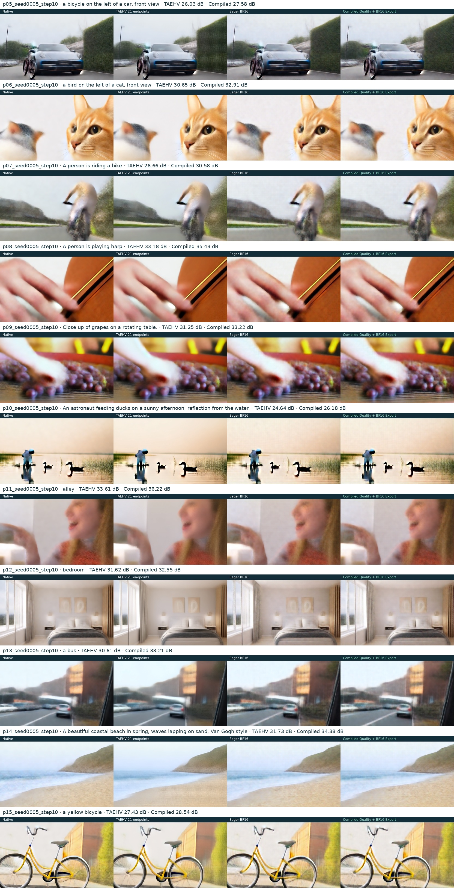

# Four-way unseen preview comparison

The [complete release bundle](https://github.com/Dylan1229/tt-scaling-diffusion/releases/tag/l2r-preview-20261007) contains the interactive HTML report and every video. Open docs/index.html after extraction.

This directory preserves compact evidence from the four-way experiment. Its bundle_checksums.json describes the full report in the release, not only this compact directory.

- [Metrics](report.json)
- [Raw timing samples](evaluation.json)
- [Frozen evaluation plan](plan.json)
- [All 11 prompts at step 10](all_prompts_step10.jpg)

